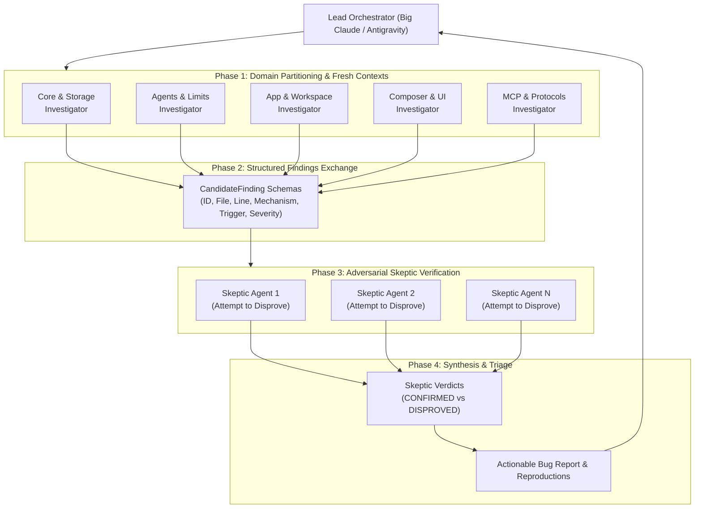

# Trek Bug Finder Workflow

A multi-agent, adversarial bug discovery and verification framework for Trek, inspired by Anthropic's dynamic workflow architecture.

## Background & Philosophy

Single AI coding agents often miss significant portions of bugs in large codebases due to:
1. **Context Window Saturation**: As an agent reads dozens of files in one context, earlier details get truncated or summarized away.
2. **Confirmation Bias**: An agent that discovers an issue or writes code is prone to rationalize its own findings and overlook mitigating safeguards.
3. **Premature Convergence**: When an agent finds a handful of bugs, it frequently concludes the job is done and stops searching.
4. **Serial Bottlenecks**: Funneling all observations into a single prompt thread degrades analytical precision.

### The Dynamic Workflow Solution



1. **Domain Partitioning**: The codebase is partitioned into distinct subsystems. Independent investigator agents are dispatched, each with a **fresh context window** and zero cognitive drift.
2. **Structured Findings Exchange**: Findings are serialized into clean, machine-verifiable JSON (`CandidateFinding`) instead of lossy conversational prose.
3. **Adversarial Skeptic Verification**: Each candidate bug is dispatched to a completely independent **Skeptic Verifier**. The skeptic's mandate is contrarian: actively attempt to disprove the bug by searching for defensive guards, type constraints, upstream validation, or by writing reproduction tests.
4. **Orchestrator Synthesis**: Only findings that withstand skeptical inquiry survive into the verified bug ledger. Disproved hypotheses are documented with reasons to eliminate false-alarm fatigue.

---

## Trek Domain Matrix

| Domain | Scope | Target Files |
|---|---|---|
| **DOMAIN_CORE** | Storage, SQLite, Skills, Settings, Paths | `crates/trek-core/src/skills.rs`, `db.rs`, `settings.rs`, `paths.rs` |
| **DOMAIN_AGENTS** | Agent Catalog, Direct LLM, Rate Limits, ACP | `crates/trek-agents/src/direct.rs`, `catalog.rs`, `limits.rs`, `acp.rs` |
| **DOMAIN_WORKSPACE** | App Workspace, Threads, Background Tasks | `crates/trek-app/src/workspace.rs`, `thread_view.rs`, `panels/` |
| **DOMAIN_COMPOSER** | Composer, Pickers, Keyboard Navigation | `crates/trek-app/src/composer/`, `settings_view/` |
| **DOMAIN_PROTOCOLS** | MCP Server, IPC, Remote Connections | `crates/trek-mcp/`, `crates/trek-ipc/`, `crates/trek-remote/` |

---

## Structured Data Schemas

### 1. Candidate Finding Schema (`CandidateFinding`)
```json
{
  "id": "FIND-CORE-001",
  "domain": "DOMAIN_CORE",
  "file": "crates/trek-core/src/skills.rs",
  "line_range": [212, 225],
  "title": "source_for misclassifies disabled skills and defaults to Project",
  "mechanism": "When restoring disabled skills from disabled_root, source_for checks prefixes. Synced skills match .claude/skills and become ClaudeCode; unknown or non-project origins fall into the final else and are marked as SkillSource::Project.",
  "trigger_condition": "A user disables a synced skill or plugin skill, then restarts Trek.",
  "severity": "Medium",
  "suggested_fix": "Preserve the original SkillSource or origin metadata directly in disabled_root, or match Synced and Plugin paths specifically."
}
```

### 2. Skeptic Verdict Schema (`SkepticVerdict`)
```json
{
  "finding_id": "FIND-CORE-001",
  "verdict": "CONFIRMED_BUG",
  "disproof_attempt": "Checked if ORIGIN_FILE stores the source enum or if discover() overrides it later.",
  "evidence": "ORIGIN_FILE only writes origin.display(). Line 202 calls source_for(&origin, project). Line 224 returns SkillSource::Project unconditionally as fallback.",
  "reproduction_status": "CONFIRMED_BY_CODE_TRACE",
  "notes": "Valid bug: non-editable skills become editable Project skills upon disablement."
}
```

---

## CLI Usage

The workflow driver is located at:
`./.agents/skills/trek-bug-finder/scripts/trek_bug_finder.py`

### Commands:
```sh
# 1. View defined domains and target file manifests
./.agents/skills/trek-bug-finder/scripts/trek_bug_finder.py domains

# 2. Run static analysis and lint probes
./.agents/skills/trek-bug-finder/scripts/trek_bug_finder.py check

# 3. Run regression and integration test probes
./.agents/skills/trek-bug-finder/scripts/trek_bug_finder.py test --quick

# 4. Audit a specific domain for common anti-patterns
./.agents/skills/trek-bug-finder/scripts/trek_bug_finder.py audit DOMAIN_CORE

# 5. Run the full automated bug finder workflow
./.agents/skills/trek-bug-finder/scripts/trek_bug_finder.py run --output report.json
```
