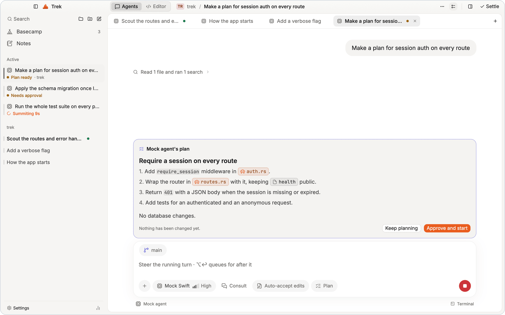
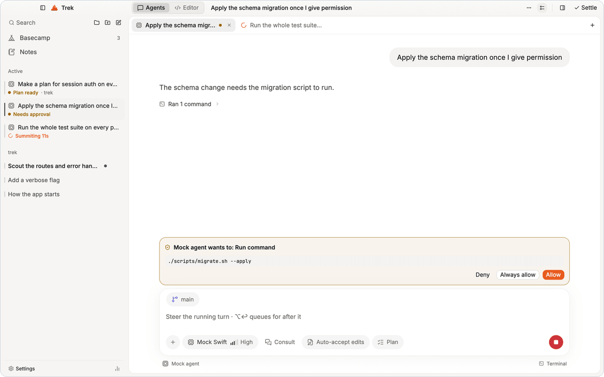
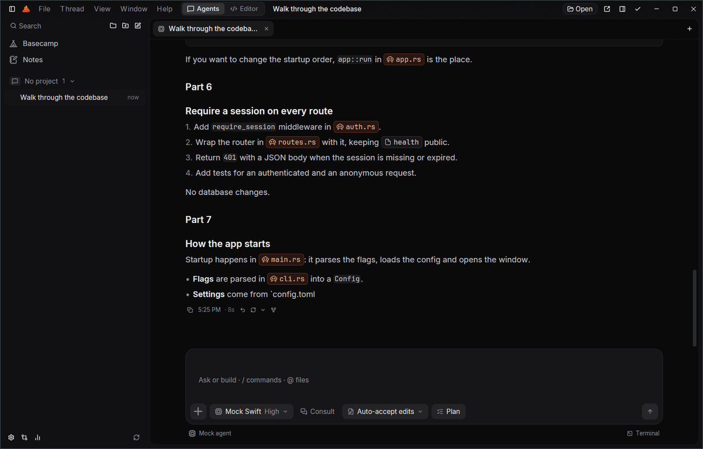
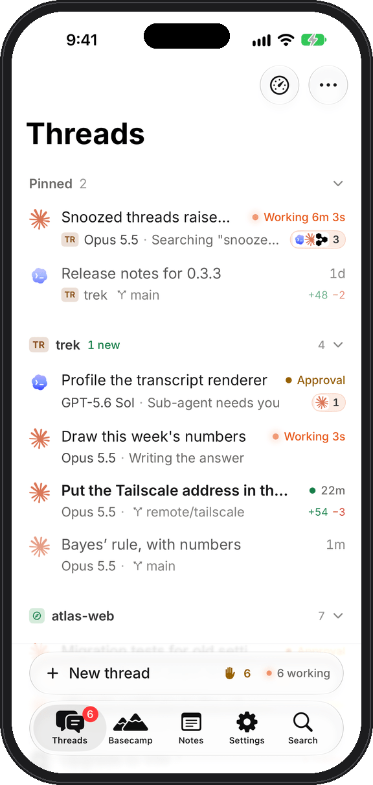
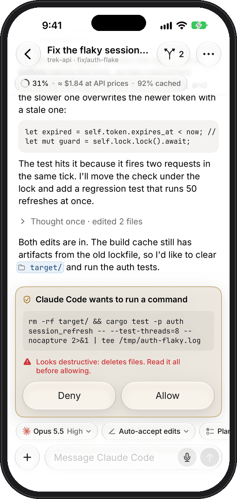
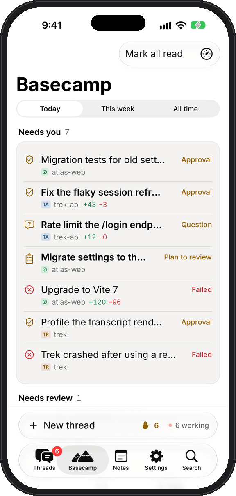
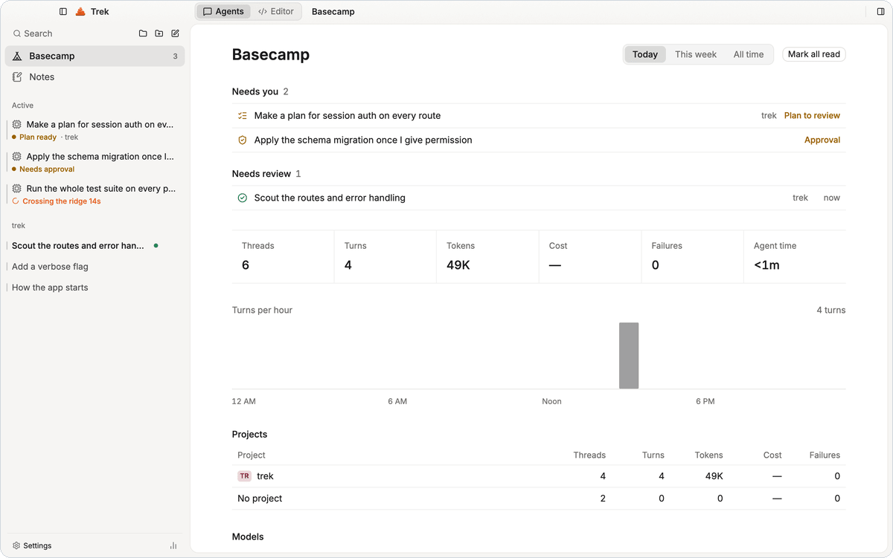
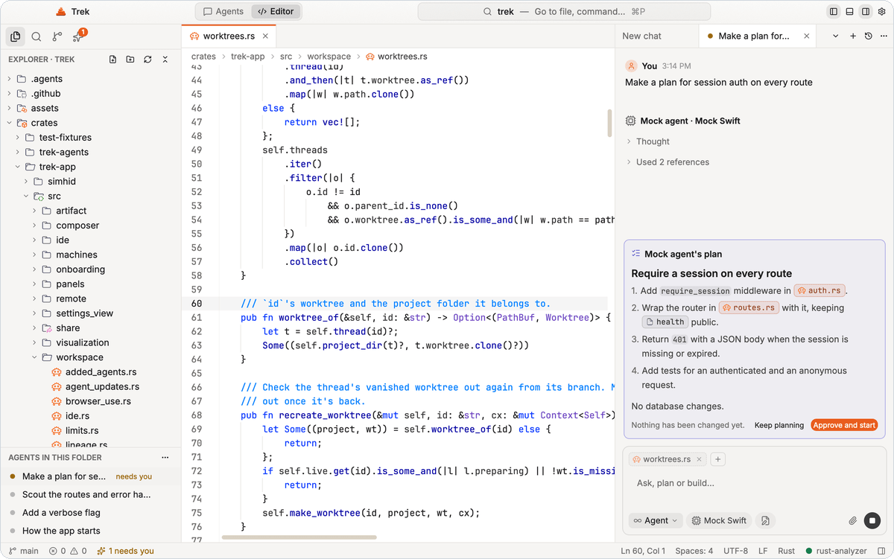
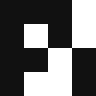

<div align="center">


<h1>Trek</h1>

<p><b>Every agent. One trail.</b></p>

<p>A native desktop app that runs your coding agents from one inbox.<br>
Claude Code, Codex, OpenCode, Cursor, Copilot, API and local models. On macOS and Windows, with an iPhone companion.</p>

<p>
  <a href="https://github.com/dokyit/Trek/releases/latest"></a>
  <a href="https://github.com/dokyit/Trek/actions/workflows/ci.yml"></a>
  <a href="LICENSE"></a>
  
</p>

<p>
  <a href="https://github.com/dokyit/Trek/releases/latest"></a>
  &nbsp;
  <a href="https://github.com/dokyit/Trek/releases/latest/download/Trek-Setup-x86_64.exe"></a>
</p>

<sub><a href="https://github.com/dokyit/Trek/releases">All releases</a> · <a href="#install">Install notes</a> · <a href="#build-from-source">Build from source</a></sub>

</div>

<br>

<picture>
  <source media="(prefers-color-scheme: dark)" srcset="docs/assets/screenshots/mac/hero-night.png">
  
</picture>

## Platforms

<table>
  <tr>
    <td width="50%" valign="top">
      &nbsp; <b>macOS</b> &nbsp;<sub>13+ · Apple silicon</sub>
      <br><br>
      <picture>
        <source media="(prefers-color-scheme: dark)" srcset="docs/assets/screenshots/mac/approval-night.png">
        
      </picture>
      <br>
      <sub>Menu bar icon, Dock badge, notifications, iOS Simulator.</sub>
    </td>
    <td width="50%" valign="top">
      &nbsp; <b>Windows</b> &nbsp;<sub>11 · x64</sub>
      <br><br>
      
      <br>
      <sub>Tray icon, taskbar badge, toasts, Mica.</sub>
    </td>
  </tr>
</table>

<table>
  <tr>
    <td colspan="3">
      &nbsp; <b>iPhone</b> &nbsp;<sub>iOS 26 · SwiftUI</sub>
      <br>
      <sub>The agents keep running on your computer; the phone is the inbox and the remote. Every thread and its status, approvals, questions and plans, steering, new threads, Notes and voice input. Built from source for now (<a href="ios/README.md">ios/README.md</a>).</sub>
    </td>
  </tr>
  <tr>
    <td width="33%" align="center">
      <picture>
        <source media="(prefers-color-scheme: dark)" srcset="docs/assets/screenshots/iphone/threads-dark.png">
        
      </picture>
      <br><sub>Threads</sub>
    </td>
    <td width="33%" align="center">
      <picture>
        <source media="(prefers-color-scheme: dark)" srcset="docs/assets/screenshots/iphone/approval-dark.png">
        
      </picture>
      <br><sub>Approvals</sub>
    </td>
    <td width="33%" align="center">
      <picture>
        <source media="(prefers-color-scheme: dark)" srcset="docs/assets/screenshots/iphone/basecamp-dark.png">
        
      </picture>
      <br><sub>Basecamp</sub>
    </td>
  </tr>
</table>

## Features

<table>
  <tr><th colspan="4" align="left">Agents and models</th></tr>
  <tr>
    <td width="25%" valign="top"><br><b>Your CLI agents</b><br><sub>With the logins you already have</sub></td>
    <td width="25%" valign="top"><br><b>API and local models</b><br><sub>Keys in the system keychain</sub></td>
    <td width="25%" valign="top"><br><b>Agents consult agents</b><br><sub>Codex reviews Claude's plan, and back</sub></td>
    <td width="25%" valign="top"><br><b>You stay in charge</b><br><sub>Four hand-holding levels, plus Plan mode</sub></td>
  </tr>
  <tr><th colspan="4" align="left">Inbox and threads</th></tr>
  <tr>
    <td valign="top"><br><b>One inbox</b><br><sub>Running and waiting threads on top</sub></td>
    <td valign="top"><br><b>Search everything</b><br><sub>Full-text search and a ⌘K palette</sub></td>
    <td valign="top"><br><b>Undo any turn</b><br><sub>Edit, retry or fork; files roll back too</sub></td>
    <td valign="top"><br><b>Bring your history</b><br><sub>Imports Claude Code, Codex and OpenCode</sub></td>
  </tr>
  <tr><th colspan="4" align="left">Review and git</th></tr>
  <tr>
    <td valign="top"><br><b>Changes per turn</b><br><sub>See, review or undo each turn's edits</sub></td>
    <td valign="top"><br><b>Worktrees</b><br><sub>Give a thread its own branch</sub></td>
    <td valign="top"><br><b>Pull request cards</b><br><sub>Checks, conflicts and merge, live</sub></td>
    <td valign="top"><br><b>Built-in editor</b><br><sub>Keep or undo the agent's hunks</sub></td>
  </tr>
  <tr><th colspan="4" align="left">Tools beside the thread</th></tr>
  <tr>
    <td valign="top"><br><b>Terminal</b><br><sub>A real one, next to every thread</sub></td>
    <td valign="top"><br><b>Browser</b><br><sub>Element picking, devtools, agent-driven</sub></td>
    <td valign="top"><br><b>iOS Simulator</b><br><sub>A live mirror with touch (macOS)</sub></td>
    <td valign="top"><br><b>Computer use and MCP</b><br><sub>Opt-in, plus your own MCP servers</sub></td>
  </tr>
  <tr><th colspan="4" align="left">Phone and machines</th></tr>
  <tr>
    <td valign="top"><br><b>Trek for iPhone</b><br><sub>Answer approvals away from your desk</sub></td>
    <td valign="top"><br><b>Push through ntfy</b><br><sub>Know when an agent needs you</sub></td>
    <td valign="top"><br><b>Your other machines</b><br><sub>Start and follow threads on them</sub></td>
    <td valign="top"><br><b>Pinned TLS pairing</b><br><sub>Over your LAN or Tailscale</sub></td>
  </tr>
  <tr><th colspan="4" align="left">Native</th></tr>
  <tr>
    <td valign="top"><br><b>Menu bar and tray</b><br><sub>Idle, working or needs you</sub></td>
    <td valign="top"><br><b>Signed updates</b><br><sub>Stable, Beta or Nightly; never mid-turn</sub></td>
    <td valign="top"><br><b>Night, Paper, glass</b><br><sub>Themes for the whole app</sub></td>
    <td valign="top"><br><b>Light and fast</b><br><sub>Rust and GPUI, drawn on the GPU</sub></td>
  </tr>
</table>

<table>
  <tr>
    <td width="50%">
      <picture>
        <source media="(prefers-color-scheme: dark)" srcset="docs/assets/screenshots/mac/basecamp-night.png">
        
      </picture>
      <p align="center"><sub><b>Basecamp</b>: today across every agent</sub></p>
    </td>
    <td width="50%">
      <picture>
        <source media="(prefers-color-scheme: dark)" srcset="docs/assets/screenshots/mac/editor-night.png">
        
      </picture>
      <p align="center"><sub><b>Editor</b>: the agent beside your code</sub></p>
    </td>
  </tr>
</table>

## Works with

Trek drives each vendor's own CLI, so your subscriptions work as they do in the terminal. Trek never reads or stores those credentials.

<table>
  <tr><th colspan="7" align="left">Agents</th></tr>
  <tr>
    <td align="center" width="14%"><picture><source media="(prefers-color-scheme: dark)" srcset="crates/trek-assets/assets/logos/dark/claude-code.png"></picture><br><sub>Claude Code</sub></td>
    <td align="center" width="14%"><picture><source media="(prefers-color-scheme: dark)" srcset="crates/trek-assets/assets/logos/dark/codex.png"></picture><br><sub>Codex</sub></td>
    <td align="center" width="14%"><picture><source media="(prefers-color-scheme: dark)" srcset="crates/trek-assets/assets/logos/dark/opencode.png"></picture><br><sub>OpenCode</sub></td>
    <td align="center" width="14%"><picture><source media="(prefers-color-scheme: dark)" srcset="crates/trek-assets/assets/logos/dark/cursor.png"></picture><br><sub>Cursor</sub></td>
    <td align="center" width="14%"><picture><source media="(prefers-color-scheme: dark)" srcset="crates/trek-assets/assets/logos/dark/github-copilot.png"></picture><br><sub>GitHub Copilot</sub></td>
    <td align="center" width="14%"><picture><source media="(prefers-color-scheme: dark)" srcset="crates/trek-assets/assets/logos/dark/droid.png"></picture><br><sub>Factory Droid</sub></td>
    <td align="center" width="14%"><picture><source media="(prefers-color-scheme: dark)" srcset="crates/trek-assets/assets/logos/dark/kimi.png"></picture><br><sub>Kimi</sub></td>
  </tr>
  <tr>
    <td align="center"><picture><source media="(prefers-color-scheme: dark)" srcset="crates/trek-assets/assets/logos/dark/qwen-code.png"></picture><br><sub>Qwen Code</sub></td>
    <td align="center"><picture><source media="(prefers-color-scheme: dark)" srcset="crates/trek-assets/assets/logos/dark/grok.png"></picture><br><sub>Grok</sub></td>
    <td align="center"><picture><source media="(prefers-color-scheme: dark)" srcset="crates/trek-assets/assets/logos/dark/devin.png"></picture><br><sub>Devin</sub></td>
    <td align="center"><picture><source media="(prefers-color-scheme: dark)" srcset="crates/trek-assets/assets/logos/dark/goose.png"></picture><br><sub>Goose</sub></td>
    <td align="center"><picture><source media="(prefers-color-scheme: dark)" srcset="crates/trek-assets/assets/logos/dark/amp.png"></picture><br><sub>Amp</sub></td>
    <td align="center"><picture><source media="(prefers-color-scheme: dark)" srcset="crates/trek-assets/assets/logos/dark/pi.png"></picture><br><sub>Pi</sub></td>
    <td align="center"><sub>+ any agent that speaks <a href="https://agentclientprotocol.com">ACP</a></sub></td>
  </tr>
  <tr><th colspan="7" align="left">API keys and local models</th></tr>
  <tr>
    <td align="center"><picture><source media="(prefers-color-scheme: dark)" srcset="crates/trek-assets/assets/logos/dark/anthropic.png"></picture><br><sub>Anthropic</sub></td>
    <td align="center"><picture><source media="(prefers-color-scheme: dark)" srcset="crates/trek-assets/assets/logos/dark/openai.png"></picture><br><sub>OpenAI</sub></td>
    <td align="center"><picture><source media="(prefers-color-scheme: dark)" srcset="crates/trek-assets/assets/logos/dark/gemini.png"></picture><br><sub>Gemini</sub></td>
    <td align="center"><picture><source media="(prefers-color-scheme: dark)" srcset="crates/trek-assets/assets/logos/dark/openrouter.png"></picture><br><sub>OpenRouter</sub></td>
    <td align="center"><picture><source media="(prefers-color-scheme: dark)" srcset="crates/trek-assets/assets/logos/dark/deepseek.png"></picture><br><sub>DeepSeek</sub></td>
    <td align="center"><picture><source media="(prefers-color-scheme: dark)" srcset="crates/trek-assets/assets/logos/dark/xai.png"></picture><br><sub>xAI</sub></td>
    <td align="center"><picture><source media="(prefers-color-scheme: dark)" srcset="crates/trek-assets/assets/logos/dark/mistral.png"></picture><br><sub>Mistral</sub></td>
  </tr>
  <tr>
    <td align="center"><picture><source media="(prefers-color-scheme: dark)" srcset="crates/trek-assets/assets/logos/dark/groq.png"></picture><br><sub>Groq</sub></td>
    <td align="center"><picture><source media="(prefers-color-scheme: dark)" srcset="crates/trek-assets/assets/logos/dark/ollama.png"></picture><br><sub>Ollama</sub></td>
    <td align="center"><picture><source media="(prefers-color-scheme: dark)" srcset="crates/trek-assets/assets/logos/dark/lmstudio.png"></picture><br><sub>LM Studio</sub></td>
    <td align="center"><sub>llama.cpp<br>MLX</sub></td>
    <td align="center" colspan="3"><sub>+ any OpenAI-compatible endpoint</sub></td>
  </tr>
</table>

<sub>API and local models get Trek's own tools (read, edit, write, run) behind the same approval gates.</sub>

## Built with

<table>
  <tr>
    <td align="center" width="96"><br><sub>Rust</sub></td>
    <td align="center" width="96"><br><sub>GPUI</sub></td>
    <td align="center" width="96"><br><sub>Tokio</sub></td>
    <td align="center" width="96"><br><sub>SQLite</sub></td>
    <td align="center" width="96"><br><sub>SwiftUI</sub></td>
  </tr>
</table>

## Install

**macOS** (13 or later, Apple silicon)

1. Download the `.dmg` from [the latest release](https://github.com/dokyit/Trek/releases/latest) and drag **Trek** to **Applications**.
2. Releases are signed but not notarized yet. On first launch, open **System Settings › Privacy & Security** and click **Open Anyway**. Or run:
   ```sh
   xattr -dr com.apple.quarantine /Applications/Trek.app
   ```
3. Install and log in to the agents you use (`claude`, `codex`, `opencode`, …). Trek finds them on your `PATH`.

**Windows** (11, x64)

1. Run [`Trek-Setup-x86_64.exe`](https://github.com/dokyit/Trek/releases/latest/download/Trek-Setup-x86_64.exe), or unpack the portable `.zip` from the [release page](https://github.com/dokyit/Trek/releases/latest) into a folder of its own.
2. Not Authenticode-signed yet: SmartScreen asks once. Click **More info › Run anyway**.

<details>
<summary>How Windows differs from the Mac</summary>
<br>

- A tray icon and taskbar badge instead of the menu bar icon and Dock badge.
- No menu bar: every command is in the palette (Ctrl+K), Settings or a context menu. Shortcuts use Ctrl where the Mac uses ⌘.
- Dictation is Windows' own (Win+H). Snapshots go through Snipping Tool.
- No iOS Simulator tool.
- The first time the phone server is on, allow Trek through Windows Firewall on private networks.
- Windows 10 22H2 works on a best-effort basis, with an opaque window instead of Mica.
- Keep Trek out of folders that Controlled folder access guards (Documents, Desktop…), or updates can't install. Settings › Updates can move it.
- Logs: `%LOCALAPPDATA%\Trek\logs`.

</details>

**iPhone**: build it from source in Xcode ([ios/README.md](ios/README.md)), then pair it in **Settings › Phone & Machines**.

**Updates**: Trek updates itself from **Settings › Updates** (Stable, Beta or Nightly). Each update is checked against a minisign signature and installed when you restart Trek, never while an agent is working.

## Build from source

macOS needs full Xcode (GPUI compiles Metal shaders); Windows needs Visual Studio 2022 Build Tools (C++) and the Windows SDK. Rust comes from [`rust-toolchain.toml`](rust-toolchain.toml).

```sh
git clone https://github.com/dokyit/Trek && cd Trek
cargo run -p trek-app        # debug build
cargo test --workspace       # what CI runs
```

On Xcode 26+, a missing Metal compiler is one command away: `xcodebuild -downloadComponent MetalToolchain`. App bundles, the mock agent and environment variables: [CONTRIBUTING.md](CONTRIBUTING.md).

## Docs

| Doc | What's in it |
| --- | --- |
| [Design decisions](docs/DECISIONS.md) | Why Trek is built the way it is |
| [iPhone design and protocol](docs/MOBILE.md) | Pairing, TLS pinning, the wire protocol |
| [Other machines](docs/MULTI-MACHINE.md) | Running a thread on another computer |
| [Performance](docs/PERF.md) | How Trek is measured, and the numbers |
| [Releasing](docs/RELEASING.md) | Channels, signing and the update path |
| [All docs](docs/README.md) | The full index |

## Status

Trek is **0.x**: used every day, moving fast. Expect rough edges.
Apple silicon and Windows x64 only (no Linux yet). History import covers Claude Code, Codex and OpenCode.
See [open issues](https://github.com/dokyit/Trek/issues) and [what's next](docs/NEXT-WAVE.md).

## Contributing

Bug reports, ideas and pull requests are welcome. Start with [CONTRIBUTING.md](CONTRIBUTING.md) and the [Code of Conduct](CODE_OF_CONDUCT.md).
Found a security issue? Please report it privately: [SECURITY.md](SECURITY.md).

## License

[Apache-2.0](LICENSE). Third-party notices are in [NOTICE](NOTICE).

<sub>Trek isn't affiliated with or endorsed by Anthropic, OpenAI, Google, Microsoft or any other maker of the agents it runs. Their names and logos belong to their owners and are shown only to say which agent a thread uses. To have a mark changed or removed, open an issue.</sub>
